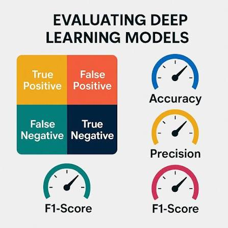

<div align="center">

# Classical Machine Learning: Model Training & Evaluation

Practical, notebook-based guides to training, tuning, interpreting, and evaluating classical machine learning models.

[](https://www.python.org/)
[](https://scikit-learn.org/)
[](https://jupyter.org/)
[](LICENSE)



</div>

## Overview

This repository is a hands-on learning collection for common classical machine learning workflows. Its Jupyter notebooks demonstrate how to prepare data, train baseline models, compare evaluation metrics, improve generalization, tune model parameters, address class imbalance, and explain model predictions.

Examples use scikit-learn and public or included datasets. A few notebooks also introduce TensorFlow/Keras, SHAP, XGBoost, and imbalanced-learn. The notebooks are educational examples; review the data preparation, assumptions, and evaluation setup before reusing a model in a real application.

## Contents

- [Learning modules](#learning-modules)
- [Repository structure](#repository-structure)
- [Datasets and saved models](#datasets-and-saved-models)
- [Requirements](#requirements)
- [Getting started](#getting-started)
- [Running the notebooks](#running-the-notebooks)
- [Working with saved models](#working-with-saved-models)
- [Contributing](#contributing)
- [License](#license)
- [Connect with me](#connect-with-me)

## Learning modules

| Module | What you will explore | Main materials |
| --- | --- | --- |
| Model training and evaluation | Train and compare classifiers; examine common classification metrics. | [`Model Training & Evaluation/`](Model%20Training%20%26%20Evaluation/) |
| Ensemble techniques | Stacking, voting, bagging, and boosting with several base estimators. | [`Ensemble Technique/`](Ensemble%20Technique/) |
| Hyperparameter tuning | Cross-validation, `GridSearchCV`, and `RandomizedSearchCV`, including a heart-disease example. | [`Hyperparameter Tuning/`](Hyperparameter%20Tuning/) |
| Overfitting, underfitting, and regularization | Use cross-validation and regularization to reason about generalization. | [`Overfitting and Underfitting/`](Overfitting%20and%20Underfitting/) |
| Imbalanced data | Compare undersampling, oversampling, SMOTE, and an ensemble approach for churn data. | [`Handling Imbalanced Data/`](Handling%20Imbalanced%20Data/) |
| Explainable AI | Use SHAP explainers and plots to inspect model predictions. | [`Explainable AI (SHAP)/`](Explainable%20AI%20%28SHAP%29/) |

## Repository structure

```text
.
├── banner.png
├── Ensemble Technique/
│   ├── Ensemble Technique.ipynb
│   └── saved ensemble model files (*.pkl)
├── Explainable AI (SHAP)/
│   └── SHAP.ipynb
├── Handling Imbalanced Data/
│   ├── Handling Imbalanced Data.ipynb
│   └── customer_churn.csv
├── Hyperparameter Tuning/
│   ├── GridSearchCV vs RandomizedSearchCV.ipynb
│   ├── Real life example.ipynb
│   ├── heart.csv
│   └── random_forest_model.pkl
├── Model Training & Evaluation/
│   └── Model Training & Evaluation.ipynb
├── Overfitting and Underfitting/
│   ├── Cross Validation/
│   │   ├── KFold Cross Validation.ipynb
│   │   ├── Project Example.ipynb
│   │   ├── solution.md
│   │   └── saved model and scaler files (*.pkl)
│   └── Regularization/
│       ├── Regularization.ipynb
│       └── Melbourne housing CSV datasets
├── LICENSE
└── README.md
```

## Datasets and saved models

The repository includes datasets for customer churn, heart disease, and Melbourne housing. Other notebooks use datasets bundled with scikit-learn, such as Iris and diabetes. Keep each notebook in its current module directory when running it so its relative dataset paths resolve correctly.

Serialized `.pkl` files are example outputs produced by the notebooks. They are not required to read or run the lessons; rerun the corresponding notebook to regenerate them. Only load pickle files from sources you trust. Pickled Python objects can execute code during loading, and compatibility may depend on the Python and scikit-learn versions used when they were created.

## Requirements

- Python 3.9 or newer
- Jupyter Notebook or JupyterLab
- Core libraries: `numpy`, `pandas`, `matplotlib`, `seaborn`, and `scikit-learn`
- Additional libraries used by specific notebooks: `shap`, `xgboost`, `imbalanced-learn`, and `tensorflow`

Install the core tools in a virtual environment:

```bash
python -m venv .venv
```

Activate it, then install Jupyter and the core packages:

```bash
# Windows PowerShell
.venv\Scripts\Activate.ps1

# macOS / Linux
source .venv/bin/activate

python -m pip install --upgrade pip
python -m pip install jupyter numpy pandas matplotlib seaborn scikit-learn
```

Install extra packages only when you need the notebook that uses them:

```bash
python -m pip install shap xgboost imbalanced-learn tensorflow
```

TensorFlow installation support depends on your operating system and Python version. Consult its official installation instructions if installation fails.

## Getting started

Clone the repository and change into its directory:

```bash
git clone https://github.com/Md-Emon-Hasan/Classical-ML-Model-Training-and-Evaluation.git
cd Classical-ML-Model-Training-and-Evaluation
```

After installing the requirements, start Jupyter from the repository root:

```bash
jupyter notebook
```

Open a module folder and run its notebook from top to bottom. Some notebooks train and save model artifacts; execution time and optional dependencies vary by lesson.

## Running the notebooks

1. Choose a learning module from the table above.
2. Open the notebook in Jupyter or upload it to a compatible notebook environment.
3. Check that the required packages are installed and the notebook's data files remain beside it in the module folder.
4. Run cells in order. Review the data split, random seed, metrics, and preprocessing choices when comparing results.
5. Save your own copy of generated outputs if you want to preserve them.

The included examples are for learning and experimentation. Metrics on the included datasets do not guarantee performance on new or production data.

## Working with saved models

Several lessons write trained estimators and preprocessing objects as `.pkl` files. If you reuse one, load it in a compatible Python environment and apply the same preprocessing used during training. For a reproducible deployment workflow, record package versions and prefer a documented model format and validation process appropriate to your application.

## Contributing

Improvements and additional examples are welcome. To contribute:

1. Fork the repository and create a feature branch.
2. Keep each notebook focused, reproducible, and clear about its dataset and dependencies.
3. Update this README when you add or rename a module or dataset.
4. Submit a pull request describing the change.

## License

This project is distributed under the Apache License 2.0. See [LICENSE](LICENSE) for the full terms.

## Connect with me

- **Portfolio:** [emonlabs-ai.hitechparks.com](https://emonlabs-ai.hitechparks.com)
- **GitHub:** [Md-Emon-Hasan](https://github.com/Md-Emon-Hasan)
- **LinkedIn:** [Md Emon Hasan](https://www.linkedin.com/in/md-emon-hasan-695483237/)
- **Hugging Face:** [emonHasan01](https://huggingface.co/emonHasan01)
- **Email:** [emon.mlengineer@gmail.com](mailto:emon.mlengineer@gmail.com)
- **WhatsApp:** [+880 1834-363533](https://wa.me/8801834363533)
